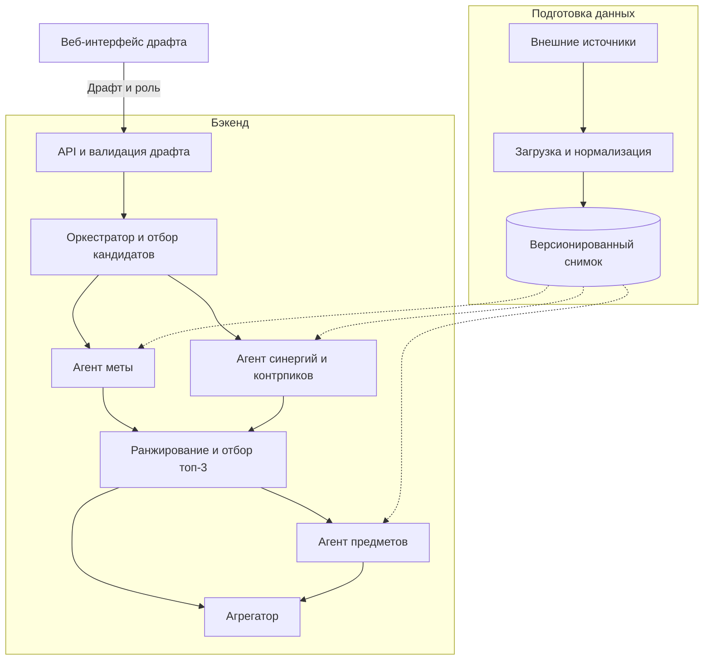
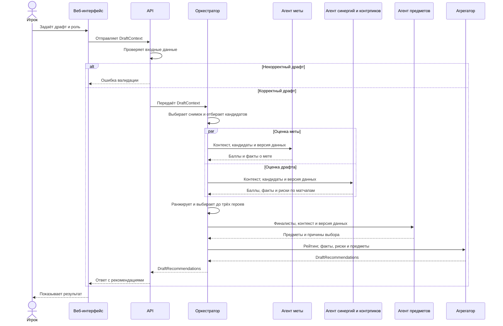

# Архитектура

Агенты MVP работают как модули одного бэкенда. Каждый получает необходимые ему данные драфта и возвращает структурированный результат. Оркестратор управляет порядком выполнения, модуль скоринга ранжирует героев, агрегатор собирает объяснения.

## Компоненты

Схема показывает путь запроса до агрегатора. Ответ возвращается в интерфейс через оркестратор и API. Снимок данных обновляется отдельно от запросов пользователей.

## Обработка запроса

## Ответственность компонентов

| Компонент | Вход | Результат |
|---|---|---|
| API | Драфт, роль и параметры анализа | Проверенный контекст или ошибка валидации |
| Оркестратор | Проверенный контекст | Отбор допустимых героев, запуск агентов и сбор результатов |
| Агент меты | Кандидаты, роль, патч и при наличии рейтинговый сегмент | Оценки меты, статистика, размер выборки и предупреждения |
| Агент синергий и контрпиков | Кандидаты, роль, союзники и противники | Оценки синергии и контрпиков, факты и риски |
| Модуль скоринга | Оценки агентов и соответствие роли | Итоговый рейтинг с разбивкой баллов |
| Агент предметов | Финалисты, роль и вражеский состав | Предметы, причины выбора, приоритеты и ограничения |
| Агрегатор | Финалисты, оценки, факты, риски и предметы | Рекомендации с объяснениями и версией данных |

Агент профиля игрока — расширение после MVP. Если появятся пригодные данные о пуле героев и опыте игрока, оценку профиля можно добавить в скоринг отдельным фактором.

## Планируемый стек

| Слой | Технологии |
|---|---|
| Интерфейс | React, TypeScript, Tailwind CSS |
| API и контракты | Python, FastAPI, Pydantic |
| Оркестрация | Python-модули |
| Хранение снимков | PostgreSQL |
| Тесты и локальный запуск | Pytest, Docker Compose |

LLM опциональна для формулировки объяснений. Скоринг вычисляется по правилам, описанным в [документации рекомендаций](recommendations.md).
